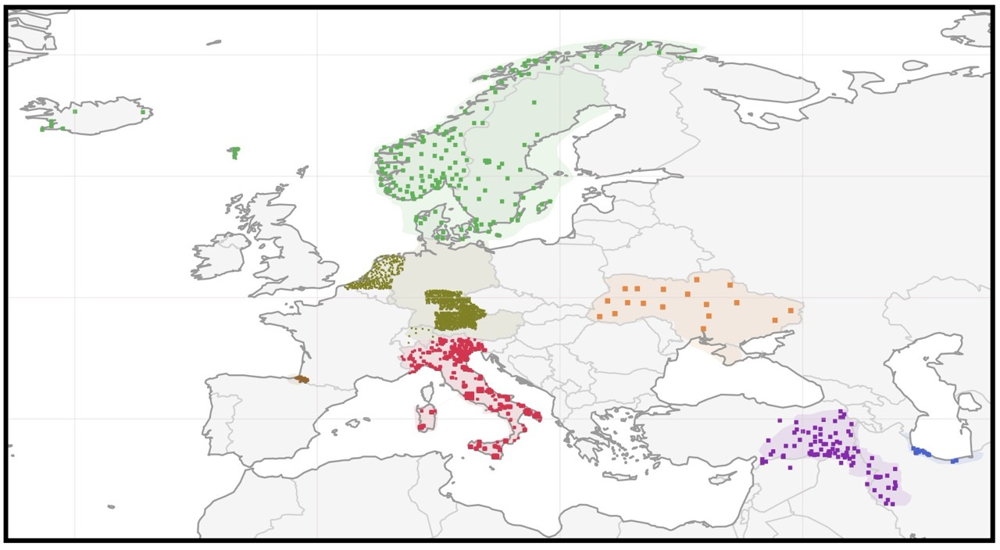
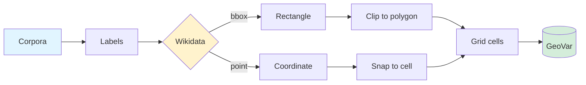

# GeoVar

<p align="center">
  
</p>

GeoVar is a collection of geolocated linguistic samples covering non-standard language varieties: dialects, regional vernaculars, and other under-documented forms. Each sample is anchored to a point (or region) on the earth's surface via Wikidata, so varieties can be treated as *geolects* rather than as opaque categorical labels.

The current release (`v0.1`) covers 929 geolects across 20 languages and 7 dialect continua in Europe and the Middle East, aggregated from existing corpora and enriched with structured geographic metadata.

This repo is a work in progress. Contributions (new corpora, corrections, better geolocations) are very welcome.

## Pipeline



* **Corpora**: existing dialect resources (see table below).
* **Labels**: location or variety names extracted from each corpus.
* **Wikidata**: labels are resolved to Q-IDs, either manually or via SPARQL.
* **Rectangle**: when Wikidata provides bounding coordinates ([P1332](https://www.wikidata.org/wiki/Property:P1332) to [P1335](https://www.wikidata.org/wiki/Property:P1335)).
* **Coordinate**: fallback when only a point ([P625](https://www.wikidata.org/wiki/Property:P625)) is available.
* **Clip to polygon**: country borders from Natural Earth trim bounding boxes to land within the correct country.
* **Grid cells**: the earth's surface discretised into cells at a chosen resolution.
* **GeoVar**: the final dataset, samples paired with cells and geographic metadata.

## Installation

```bash
git clone https://github.com/sinaahmadi/GeoVar.git
cd GeoVar
pip install -r requirements.txt
```

Cartopy requires the GEOS and PROJ system libraries. On macOS with Homebrew: `brew install geos proj`. On Debian/Ubuntu: `sudo apt install libgeos-dev libproj-dev`. 

Alternatively, install via conda for fewer headaches:
`conda install -c conda-forge cartopy geopandas`.

## Data Sources

| Name | Continuum | Languages | # Geolects | Reference | Source | License |
|---|---|---|---:|---|---|---|
| BASYQUE | Basque | Basque | 40 | Uria & Etxeberria (2011) | [link](https://github.com/mahfuzibnalam/dialect_mt/tree/main/Basque) | CC BY-NC-SA 3.0 |
| ScanDiaSyn | North Germanic | Icelandic, Ovdalian, Faroese | 19 | Johannessen et al. (2011) | [link](https://tekstlab.uio.no/nota/scandiasyn/) | CC BY-NC-SA 4.0 |
| DanDiaSyn | North Germanic | Danish | 13 | Johannessen et al. (2011) | [link](https://tekstlab.uio.no/nota/scandiasyn/) | CC BY-NC-SA 4.0 |
| SweDiaSyn | North Germanic | Swedish | 31 | Johannessen et al. (2011) | [link](https://tekstlab.uio.no/nota/scandiasyn/) | CC BY-NC-SA 4.0 |
| NorDiaSyn | North Germanic | Norwegian | 108 | Johannessen et al. (2011) | [link](https://tekstlab.uio.no/nota/scandiasyn/) | CC BY-NC-SA 4.0 |
| SAND | West Germanic | Dutch | 267 | Barbiers et al. (2007) | [link](https://sand.meertens.knaw.nl/zoeken/) | CC BY-NC-SA 3.0 |
| Betthupferl | West Germanic | German | 7 | Blaschke et al. (2025) | [link](https://github.com/mainlp/betthupferl) | All rights reserved |
| SwissDial | West Germanic | Swiss German | 8 | Plüss et al. (2021) | [link](https://mtc.ethz.ch/publications/open-source/swiss-dial.html) | Free for research use |
| ASIt | Italic | Italian varieties | 313 | Pescarini (2010) | [link](http://svrims2.dei.unipd.it:8080/asit-maldura/pages/search.jsp) | Attribution via citation |
| PARME | Caspian, Kurdic | Mazandarani, Gilaki, Talysh, Hawrami, S. Kurdish, Laki Kurdish | 28 | Ahmadi et al. (2025) | [link](https://github.com/DOLMA-NLP/PARME) | MIT |
| CORDI | Kurdic | Central Kurdish | 5 | Ahmadi et al. (2024) | [link](https://github.com/sinaahmadi/CORDI) | CC BY-SA 4.0 |
| Matras (2019) | Kurdic | Northern Kurdish | 72 | Matras (2019) | [link](https://www.kratylos.org/~raphael/kurdish/database-of-kurdish-dialects/index.html) | Attribution via citation |
| Fründ (2026) | Ukrainian | Ukrainian | 18 | Fründ (2026) | [link](https://github.com/yfrund/ukrainian_dialects) | MIT |
| **Total** | | | **929** | | | |

Each source comes with its own license and citation requirements. Please consult the linked pages and cite the original authors when using any subset of GeoVar.

Preprocessing differs per source (short utterance filtering, transcription marker removal, sentence splitting, deduplication). The exact steps applied to each corpus are in [`variety_map.ipynb`](./variety_map.ipynb).

## Implementation

The first step to represent a geolect is making sure that the location exists in `variety2Wikidata.tsv`. This file maps location names to their entries on Wikidata:

| Country | Language | Location | Wikidata |
|---|---|---|---|
| Italy | Italian | Maserà di Padova | https://www.wikidata.org/wiki/Q34519 |
| Italy | Italian | Gazzo | https://www.wikidata.org/wiki/Q34521 |
| Italy | Italian | Ariano Irpino | https://www.wikidata.org/wiki/Q55000 |

Based on the Wikidata entity, we then extract either exact coordinates or a bounding polygon, saved in `regions_cache.tsv`:

```
Q34519	Maserà di Padova	Italy	Italian	bbox	45.2796398	45.3381666	11.8186594	11.9047085
Q34521	Gazzo	Italy	Italian	bbox	45.5378537	45.5961961	11.652934	11.7272133
Q55000	Ariano Irpino	Italy	Italian	bbox	41.0808557	41.2648229	14.9896333	15.223686
```

This is all that is needed to place locations on the geogrid. Two utility scripts help populate these files:

* [`enrich_locations_wikidata.py`](./util/enrich_locations_wikidata.py): batch enricher that takes a `{language: {location: [utterances]}}` JSON, resolves each location to a Wikidata Q-ID with coordinates and settlement metadata, and writes a `location_index.json`. Run this once per new corpus.
* [`location_retriever_SPARQL.py`](./util/location_retriever_SPARQL.py): lightweight ad-hoc lookup for individual place names, useful for filling in locations that the batch enricher failed to resolve.

> [!NOTE]
> You might sometimes want to override what Wikidata returns. In that case, add the location with your preferred coordinates to `regions_cache_overrides.tsv` and the pipeline will use that instead. Manual checking is worth the effort: it is common to find several distinct places sharing the same label.

> [!TIP]
> If there is no suitable Q-item on Wikidata for your region of interest, you can use the tool at [`util/region-mapper.html`](./util/region-mapper.html) to draw a polygon on a map and export it as GeoJSON.

The final dataset is saved to `dialect_data.json`.


## License

The code in this repository is released under the [MIT License](./LICENSE).

The aggregated dataset is released under [CC BY-NC-SA 4.0](./LICENSE-DATA), but **each underlying corpus is governed by its own license** (see the Data Sources table). When using any subset of GeoVar, please respect and cite the license of the original corpus. Several sources are non-commercial (NC); do not use the aggregated data for commercial purposes.

## Citation

```bibtex
@inproceedings{ahmadi-sennrich-2026-language,
    title = "Language Identification for Non-Standard Varieties: Language Varieties as Geolects on a Geodesic Grid",
    author = "Ahmadi, Sina and Sennrich, Rico",
    booktitle = "Proceedings of the 2026 Conference on Empirical Methods in Natural Language Processing",
    month = oct,
    year = "2026",
    publisher = "Association for Computational Linguistics",
}
```